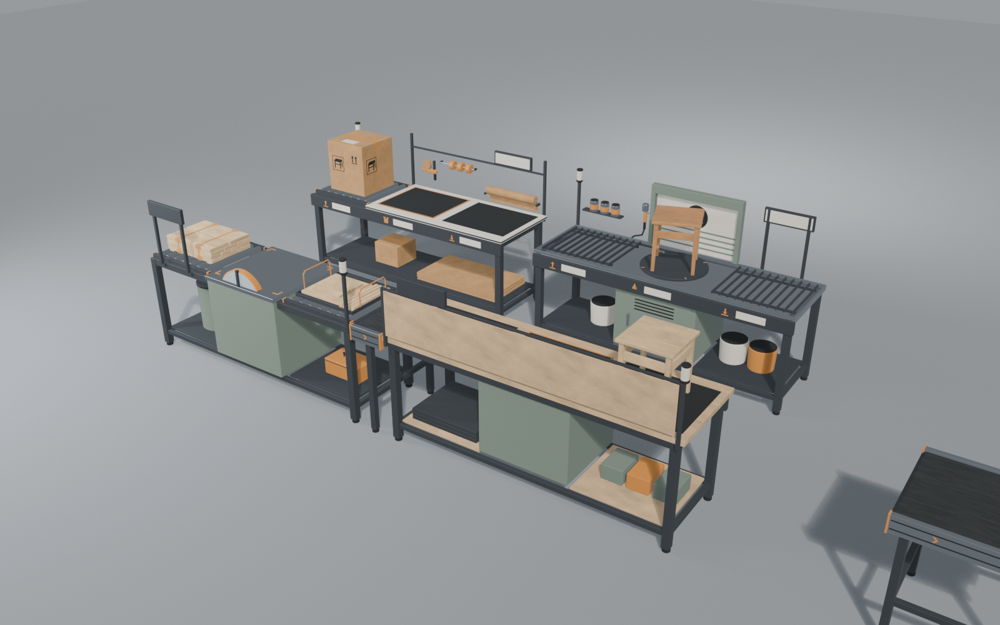

# HQ-Assets · Serie 1 Produktionslinie

20.11.2026, Opus 5.5 im Lead-Auftrag von Jonas („high quality assets vorbereiten, Meilensteine vorerst ignorieren“). Blender-Quelle, Exporte und Ansichten liegen vor. Studio-Import, Spielkamera-Abnahme und Gerätemessung stehen noch aus. Es gibt keine Art-Freigabe nach P03-07.

## Umfang

| Asset | Inhalt | Dreiecke | MeshParts | Hülle B × T × H m |
|---|---|---:|---:|---|
| `Hocker01_Raw` / `_Finish` | Sitz aus drei verleimten Lamellen, Zapfen sichtbar, Dübel, innen verjüngte Beine, Etikett | 1.848 | 2 | 0,40 × 0,40 × 0,45 |
| `Hocker01_Kit` | Stahlträger mit Griffbügeln, neun Teile exakt in der Packlage nach P01-03 | 2.052 | 4 | 0,60 × 0,50 × 0,18 |
| `Holzpaket01` | Rohbretter, Kufen, zwei PET-Bänder, Kantenschutz, Symbolschild | 1.688 | 4 | 0,58 × 0,44 × 0,145 |
| `Hockerkarton01` | Kraftkarton, orangefarbenes Werksband, Hocker-Piktogramm, „Oben“-Pfeile, zwei Etikettfelder | 920 | 4 | 0,46 × 0,46 × 0,51 |
| `Saege01` | Rollenbahnen Ein/Aus, Stahltisch, 0,40-m-Blatt hinten mit Haube und Klarschutz, Schaltschrank, Not-Halt | 7.636 | 10 | 2,37 × 0,80 × 1,43 |
| `Montagebank01` | Buchen-Leimholzplatte, drei Gummimatten, Werkzeugwand, Schubladenschrank, leere Träger | 5.272 | 8 | 2,40 × 0,80 × 1,43 |
| `Finishplatz01` | Auffangwanne, Trockenroste, Drehteller, Filterwand mit Lüfter, Sprühpistole, Dosen | 6.788 | 10 | 2,37 × 0,78 × 1,44 |
| `Packtisch01` | Laminatplatte, Kraftpapierrolle, Klebebandrollen, Abroller, Kartonzuschnitte, Rollenbahn Aus | 5.680 | 7 | 2,39 × 0,80 × 1,43 |
| `Band01_1m` / `Band01_030` | Gerades Band 0,70 m Nutzbreite, Profil mit T-Nuten, Flussrichtungspfeile, orange Anschlusskappen, Motor (1 m) | 1.776 / 840 | 6 / 5 | 1,00 bzw. 0,30 × 0,80 × 0,92 |

Alle Maße folgen dem [Maßvertrag](../../docs/design/DIMENSIONS.md). Die Auflagen liegen bei Z = 0,90 m mit den Mittelpunkten X = −0,80 / 0 / +0,80, darüber bleibt bis 1,45 m kein festes Teil. Eingang −X, Ausgang +X, Bedienseite +Y (Blender). Die Liste stammt aus `manifest-goods.json` und `manifest-stations.json`.

## Vorläufiges Budget (Zielgerät: schwächeres Android, Grafikstufe 1)

| Gruppe | Dreiecke | MeshParts | Ist |
|---|---:|---:|---|
| Ware (wird mehrfach gleichzeitig gezeigt) | ≤ 2.500 | ≤ 4 | max. 2.052 / 4 |
| Station | ≤ 8.000 | ≤ 10 | max. 7.636 / 10 |
| Bandmodul | ≤ 2.500 | ≤ 6 | max. 1.776 / 6 |
| Halle: 4 Stationen + 2 Bänder + 12 Waren | ≤ 60.000 | ≤ 90 | rund 48.400 / 86 (je 3 Pakete und Träger, je 2 Hocker roh und fertig, 2 Kartons) |

Texturen: fünf gemeinsame, kachelbare Sätze (`WoodRaw`, `WoodFinish`, `WoodBench`, `Cardboard`, `Rubber`), je Farbe, Normal und Rauheit, 512 × 512 px für 0,5 m. Das ergibt etwa 1.000 px/m, ungefähr die Dichte der Roblox-Standardmaterialien. Lack, Stahl, Gummi und Kunststoff kommen ohne Textur aus, nur über MeshPart-Farbe und Material. Die Werte sind vorläufige Annahmen, bis die Messung auf dem Zielgerät vorliegt (P11-05, P09-09). Dann wird das Budget bestätigt oder angepasst.

## Aufbau der Modelle

- **Ein Mesh je Material.** Jede Gruppe wird pro Material zu genau einem Objekt `Asset__Material` zusammengefasst, damit ein Modell nur wenige MeshParts und Draw Calls kostet. Bewegliche oder umfärbbare Teile bilden eigene Gruppen: `Saege01__Blade__BareSteel` (dreht um `BladeAxis`), `Finishplatz01__Turntable__*` (dreht um `TurntableAxis`), `Finishplatz01__Fan__BareSteel` (dreht um `FanAxis`) und `*__StatusLamp__WallWhite`. Die Statuslampe setzt Studio je nach Zustand auf Farbe und Neon.
- **Kanten.** Alle harten Kanten sind im Mesh gefast und mit gewichteten Normalen schattiert. Die Silhouetten bleiben dadurch weich, ohne gebackene Normal-Maps.
- **Holz.** Die UVs laufen je Bauteil längs der Faser, mit gleicher Texeldichte in der ganzen Serie. Rohhocker und Finishhocker teilen die Maserung, nur das Material wechselt.
- **Sprache.** Es gibt keine Wörter in Mesh oder Textur. Leere Schildflächen tragen Marker (`Label_*`) als Anker für SurfaceGui-Text in EN und DE. Auflagen-Icons sind richtungsfrei: „ablegen“ ist ein Pfeil nach unten, „abholen“ ein Pfeil nach oben, die Bearbeitung ein Symbol (Sägeblatt, Hammer, Tropfen, Karton). So funktionieren sie auch in gespiegelten, um 180° gedrehten Reihen.
- **Marker** (nur in Blend und Manifest, nicht im Export). `Pad_In/Process/Out`, `Label_*`, `StatusLamp`, Drehachsen, `Grip` an den Waren, `In/Out/Buffer` am Band. Das Manifest nennt jede Position in Blender-Metern und in Roblox-Studs.

## Dateien

| Pfad | Zweck |
|---|---|
| `exports/*.glb` | Upload-Datei für den Roblox-3D-Import, Texturen eingebettet |
| `exports/*.fbx` | Projektkonvention (`axis_forward=-Z`, `axis_up=Y`, Meter), verweist auf `textures/` |
| `textures/` | Kachelbare PBR-Sätze, fünf Stück mit je Farbe, Normal und Rauheit. Die ungenutzten `Paint*`-Reste sind am 24.11.2026 entfernt. |
| `manifest-*.json` | Dreiecke, MeshParts, Hüllen, Marker und Roblox-Materialzuordnung je Material |
| `roundtrip.json` | 22 Rückimporte (GLB und FBX): Maß < 1 mm, Boden Z = 0, MeshParts und Dreiecke identisch |
| `renders/` | Linie aus zwei Richtungen, vier Stationen, Waren |
| `hq-assets-v1.blend` | Arbeitsstand, Texturen relativ verknüpft. `hq-assets-v1.blend1` ist Blenders automatische Sicherung eines älteren Zwischenstands mit 34 MB und kann weg. |
| `tools/` | `textures.py` (normales Python mit numpy und Pillow), `hqlib.py`, `hqdecal.py`, `build_goods.py`, `build_stations.py`, `roundtrip.py`, `render.py`, `run_all.py` |

Neu aufbauen: zuerst `python assets/hq/tools/textures.py`, danach in Blender 5.1 `tools/run_all.py` ausführen. Das Skript baut alle Assets, exportiert, prüft per Rückimport, rendert und speichert. Es legt nur die Collections `HQ_Goods`, `HQ_Stations` und `HQ_Preview` neu an.

## Übernahme in Studio (offen, braucht Upload-Freigabe)

1. GLB einmal je Asset hochladen. Den Maßstab 25/7 Studs je Meter genau einmal anwenden und mit `ControlCube_1m` aus P03-05 gegenprüfen.
2. Materialien nach `manifest-*.json` → `materials` zuordnen. Bei `flat` wird eine eventuell erzeugte SurfaceAppearance entfernt, `Color` und `Material` werden gesetzt, `ClearGuard` erhält zusätzlich `Transparency` 0,6. Bei `SurfaceAppearance` werden Color-, Normal- und RoughnessMap verwendet.
3. Sichtmeshes: `CanCollide`, `CanTouch` und `CanQuery` aus. Kollision und Plätze bleiben bei der vorhandenen Greybox (`Workspace.P02Line`). Die Assets werden als Sichtschicht über die Slot-Anker gelegt.
4. `Label_*` erhalten SurfaceGui mit `LocalizationTable`-Schlüsseln. Die Statuslampe wird an den Stationszustand gebunden, Blatt, Drehteller und Lüfter an den laufenden Prozess.
5. Ansichten nach P03-06 aufnehmen: Spielkamera, Nahansicht, kleine Bildschirmansicht.

## Offen

- Studio-Import und Spielkamera-Prüfung. Upload nur mit ausdrücklicher Freigabe.
- Messung auf dem Zielgerät, um das Budget zu bestätigen.
- Folgeserien mit demselben Baukasten: Architektur (Wand, Fenster, Ecke, Dach, Traufe/Ortgang, First, Boden, Tor, Leuchte), Fahrzeug (Quad, Anhänger, Ladeplätze) und Route (Gerade, Kurve, Abzweig, Übergabefläche, vier Zielorte).
- Sichtbarer Sägeschnitt: Das Blatt dreht hinten, das Werkstück wird im Prozess vorbeigeführt. Die Animation legt Studio fest.
