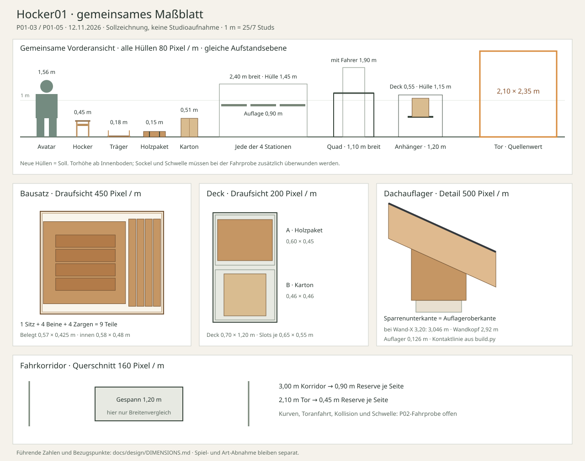

# Warenzustände und gemeinsames Maßblatt

Stand 12. November 2026. **P01-03 / P01-05**, Entwurf für `Hocker01`, Version 1. Neue Waren-, Stations- und Fahrzeugmaße sind Sollwerte für die Greybox. Vorhandene Werkstattmaße sind getrennt als Quellenwerte gekennzeichnet. Es wurde kein neues Modell importiert oder im Spiel vermessen.

[Rezept und Stationen](PRODUCTION.md) · [Verladekette](LOGISTICS.md) · [Art Direction](ART.md) · [Maßvergleich als SVG](../evidence/P01-massblatt.svg) · [Prüfbeleg](../evidence/P01-03-06.md)

## Einheiten, Achsen und Bezugspunkte

Führend sind **Meter**. Der Maßfaktor ist **25/7 Studs je Meter**, also `Studs = Meter / 0,28`, passend zur vorbereiteten Werkstatt. Tabellenwerte in Studs sind auf drei Stellen gerundet; berechnet wird vor dem Runden. Grobraster: 0,05 m = 0,179 Studs, Detailraster: 0,005 m = 0,018 Studs.

Alle Maße sind **X × Y × Z = Breite × Höhe × Tiefe**, einschließlich Griffe, Kanten und Befestigungen. In Roblox liegt Y oben. Neue Blender-Quellen verwenden Meter und Z oben; ihre Achsen werden beim Export/Import als `(X, Y, Z) → (X, Z, -Y)` zugeordnet. Ein 1-m-Kontrollkörper muss nach dem gesamten Importweg 3,571429 Studs messen. Der Faktor wird genau einmal angewendet. Der Sonder-Reparaturweg der bestehenden Werkstatt wird nicht zusätzlich auf neue, bereits korrekt skalierte Waren angewendet.

Der Warenpivot liegt bei `(0, 0, 0)` in der **Mitte der äußeren Grundfläche auf der untersten Auflageebene**. Bei Hockern ist das die Bodenebene zwischen den vier Fußenden; bei Paket, Träger und Karton die äußere Unterseite. Lokales -Z ist die markierte Bezugsrichtung. Beim Ablegen wird dieser Pivot auf den Auflagemittelpunkt gesetzt, ohne Größenänderung. Die Ware bleibt aufrecht; nur die Drehung um Y ist zulässig und muss zur Slotgrundfläche passen.

## P01-03 · Fünf Warenzustände

Jede Zeile beschreibt dieselbe Charge mit unveränderter ID, Eigentümer und Rezeptversion, Menge jeweils **1**. Die neun eingebetteten Holzteile bleiben gemeinsam; Träger und Verpackung bilden keine zweite Charge. Eine kurze Chargenkennung, Stufentext und ein Formsymbol bleiben an der jeweiligen Darstellung sichtbar.

| Stufe | Darstellung | Außenmaß m | Außenmaß Studs | Zulässige Transportarten |
| --- | --- | --- | --- | --- |
| Holzpaket | Ein gebündelter vollständiger Rohteilesatz mit zwei Bändern und Sitz-/Bein-/Zargensymbol | 0,60 × 0,15 × 0,45 | 2,143 × 0,536 × 1,607 | Hand; später Personal und Band intern; befestigt in genau einem Fahrzeugslot auf Beschaffungsfahrt |
| Offener Bausatz | Flacher Träger, 1 Sitzplatte, 4 einzeln erkennbare Beine und 4 Zargen, niedriger Rand und offene Sicht von oben/vorn | 0,60 × 0,18 × 0,50 | 2,143 × 0,643 × 1,786 | Hand; später Personal und Band intern; keine normale Außenfahrt |
| Rohhocker | Montierte Sitzplatte auf 4 Beinen und 4 Zargen, rohe Oberfläche, Stufenschild „Rohhocker“ | 0,40 × 0,45 × 0,40 | 1,429 × 1,607 × 1,429 | Hand; später Personal und Band intern; aufrecht; keine normale Außenfahrt |
| Fertiger Hocker | Dieselbe Geometrie mit Finish und Stufenschild „Fertig“ | 0,40 × 0,45 × 0,40 | 1,429 × 1,607 × 1,429 | Hand; später Personal und Band intern; aufrecht; keine normale Außenfahrt |
| Geschlossener Karton | Passender Karton mit Hockersymbol, „1 Hocker“ und Chargenkennung | 0,46 × 0,51 × 0,46 | 1,643 × 1,821 × 1,643 | Hand; später Personal und Band intern; befestigt in genau einem Fahrzeugslot auf Verkaufsfahrt |

Hand, Mitarbeiter und ein Bandabschnitt führen jeweils höchstens **eine ganze Charge**. Eine Hand trägt Paket/Träger/Karton unterseitig, den Hocker am Gestell, mit sichtbarer Ware vor dem Körper. Geplante Warenunterseite beim Tragen: 0,70 m über der Aufstandsebene; maximaler Warenabschluss: 1,21 m beim Karton. Fahrten beginnen mit freien Händen, damit es keine zusätzliche Handladung auf dem Fahrer gibt. Stapeln und lose Teilentnahme sind im ersten Rezept unzulässig.

### Einzelteile, Montage und Packlage

| Teil | Anzahl | Maß m in seiner Fertigungslage | Lage im montierten Hocker |
| --- | --- | --- | --- |
| Sitzplatte | 1 | 0,40 × 0,025 × 0,40 | Y = 0,425 bis 0,450; zentriert über dem Gestell |
| Bein | 4 | 0,035 × 0,425 × 0,035 | Mittelpunkte X/Z = jeweils ±0,1625; Fuß Y = 0; Kopf endet bündig unter dem Sitz |
| Zarge | 4 | 0,29 × 0,06 × 0,02 | Zwei entlang X, zwei um 90° gedreht; Y = 0,30 bis 0,36; Enden stoßen an die Beininnenseiten |

Das Gestell hat außen 0,36 × 0,36 m; der Sitz steht rundum 0,02 m über. Zwischen gegenüberliegenden Beininnenseiten liegen `0,325 - 0,035 = 0,29 m`, passend zur Zargenlänge. Verbindungen liegen an diesen Kontaktflächen und werden sichtbar ausgearbeitet; zusätzliche Verbindungsdetails bleiben innerhalb der Hülle. Der dekorative dreibeinige Hocker in der vorhandenen Werkstatt ist kein Produktionsmuster für dieses vierbeinige Rezept.

Der Träger besitzt einen 0,01 m starken Boden und seitlich 0,01 m Material. Sein nutzbarer Grundriss beträgt **0,58 × 0,48 m**. Der niedrige Rand endet bei Y = 0,03 m; offene Griffe an den Außenkanten reichen bis 0,18 m, ohne den nutzbaren Grundriss zu schneiden. Er ist keine 0,18 m hohe geschlossene Kiste.

Konkrete Packlage relativ zum Warenpivot, in Metern:

- Sitz: X = -0,285 bis +0,115; Z = -0,20 bis +0,20; Y = 0,01 bis 0,035.
- Vier liegende Beine: längs Z von -0,2125 bis +0,2125; ihre X-Unterkanten sind 0,130 / 0,170 / 0,210 / 0,250, jeweils Breite 0,035. Y = 0,01 bis 0,045. Zwischen den Beinen bleiben 0,005 m sichtbare Fugen.
- Vier flach liegende Zargen: X = -0,225 bis +0,065; Z-Mittelpunkte -0,105 / -0,035 / +0,035 / +0,105, jeweils Breite 0,06; Y = 0,035 bis 0,055. Sie liegen auf dem Sitz, ohne die Beine zu verdecken.

Die belegte Grundfläche ist damit **0,57 × 0,425 m**; die Holzoberkante liegt bei Y = 0,055 m. Das passt auch in die Holzpakethülle: bei 0,01 m Kantenschutz rundum bleiben innen **0,58 × 0,13 × 0,43 m**. Die kleinste Luft beträgt 0,005 m je X-Seite und 0,0025 m je Z-Seite; Modellierung, Kanten und Kollisionshüllen müssen innerhalb dieser Zugabe bleiben. Die Paketpolsterung gehört zu den pauschalen Hilfsmitteln. Der Zuschnitt ist im Prüfmodell das Kalibrieren der vorportionierten Bauteile ohne separat gebuchte Verschnittmenge; ihre Nennhüllen und die Holzbilanz ändern sich dabei nicht.

Der Karton hat 0,01 m Wand-, Boden- und Deckelstärke. Innen bleiben **0,44 × 0,49 × 0,44 m**. Der Hocker steht darin aufrecht, zentriert, mit Unterseite Y = 0,03 m über der Kartonunterseite. Er hat innen 0,02 m Abstand zu jeder Seitenfläche sowie oben und unten. Die Holzgeometrie wird beim Verpacken nicht verkleinert.

## P01-05 · Gemeinsame Vergleichsansicht

Die SVG zeigt alle Vergleichsobjekte mit gemeinsamem Höhenmaßstab sowie getrennt beschriftete Draufsichten und den Dachanschluss. Sie ist eine Sollzeichnung, keine Studioaufnahme.

| Objekt | Maß m, X × Y × Z soweit räumlich | Entsprechung in Studs / Bezug |
| --- | --- | --- |
| Avatar-Prüfhülle | 0,60 × 1,56 × 0,50 | 2,143 × 5,571 × 1,786; Fußebene. Die Höhe entspricht ungefähr dem früher gemessenen Avatar; Breite/Tiefe sind reservierter Planungsraum, alle später erlaubten Avatare benötigen die Passprobe. |
| Hocker / Träger / Paket / Karton | Siehe Waren- und Einzelteiltabellen | Unterseitenpivot, keine abweichende Vergleichsskalierung |
| Jede Station | 2,40 × 1,45 × 0,80 | 8,571 × 5,179 × 2,857; Gehäusehülle ohne Bediengang, Auflagehöhe 0,90 m = 3,214 Studs |
| Jede Ein-/Ausgangs- und Prozessauflage | 0,70 × 0,60 m Grundfläche | 2,500 × 2,143 Studs; Mittelpunkte stationlokal X = -0,80 / 0 / +0,80, Y = 0,90, Z = 0 |
| Gerades Band | 0,70 m nutzbare Breite, Auflage Y = 0,90 m | 2,500 Studs breit; übernimmt denselben Auflagemittelpunkt; Abstand benachbarter Slotmitten nach Stellplan |
| Bediengang | mindestens 1,20 m frei | 4,286 Studs; zum Wenden mit Handware, keine Lagerplätze im Gang |
| Quad | 1,10 × 1,20 × 2,00 | 3,929 × 4,286 × 7,143; mit Fahrer maximal geplante Höhe 1,90 m = 6,786 Studs |
| Anhänger inkl. Reifen, Kotflügeln und Deichsel | 1,20 × 1,15 × 2,00 als beladene Prüfhülle | 4,286 × 4,107 × 7,143; unterster Radpunkt, Ladefläche 0,55 m = 1,964 Studs über Fahrbahn |
| Anhängerdeck / zwei Slots | Deck 0,70 × 1,20 m; je Slot 0,65 × 0,55 m Grundfläche | Deck 2,500 × 4,286 Studs; Slots längs hintereinander, jeder 1 Holzpaket oder 1 Karton |
| Gerades Gespann | 1,20 × 1,90 × 4,15 | 4,286 × 6,786 × 14,821; inklusive 0,15 m Kupplungsbereich zwischen den Fahrzeughüllen |
| Vorhandenes Tor, Quellenwert | lichte Breite 2,10 m, Höhe 2,35 m ab Innenboden | 7,500 × 8,393 Studs; aus Türrahmen und Kollisionsquelle, tatsächliche fahrbare Hülle noch zu prüfen |
| Geplanter Fahrkorridor | 3,00 m frei; gerade Toranfahrt mindestens 5,00 m | 10,714 / 17,857 Studs; Kurveninnenradius vorläufig 4,00 m, Wendefläche 10,00 × 10,00 m |

Die drei Auflagen einer Station liegen mit je 0,10 m Abstand nebeneinander und mit 0,05 m Rand innerhalb ihrer Breite. Die größte Ware, der Träger, erhält auf einer Auflage 0,05 m Rand auf allen Grundrissseiten. Über jeder Auflage bleibt bis mindestens Y = 1,45 m ein freier Warenraum; Sägeblatt, Hauben und Gestell dürfen diesen nicht mit unbeweglicher Geometrie belegen. Der Karton erreicht auf dem Tisch Y = 1,41 m. Die Montageposition lässt den Hocker zwischen allen Stationen gleich groß bleiben.

Auf dem Anhänger liegen beide Slots längs zur Fahrt. Relativ zur Mitte der vollständigen Anhängerhülle ist das Deck bei X = 0, Y = 0,55, Z = +0,25 m zentriert. Die Slotmittelpunkte liegen bei **(0; 0,55; -0,05)** und **(0; 0,55; +0,55)** m. Ware liegt direkt auf dem Deck und wird an sichtbaren Zurrpunkten befestigt. Ein Karton erreicht Y = 1,06 m; die Prüfhülle 1,15 m enthält Raum für die Befestigung. Holzpakete werden mit ihrer 0,60-m-Achse quer zur Fahrt geladen; 90° gedreht überschreiten sie die 0,55-m-Slottiefe und werden so nicht angenommen.

**Rechnerische Passungen:** Kartoninnenseite minus Hocker = 0,04 m je Achse, also 0,02 m Luft je Seite. Größte Fahrzeugware Holzpaket 0,60 × 0,45 m passt in 0,65 × 0,55 m. Die Trägergrundfläche 0,60 × 0,50 m passt ebenfalls geometrisch, ist jedoch nur für interne Transporte freigegeben. Tor minus Gespannbreite = 0,90 m, also 0,45 m je Seite; Torhöhe minus Fahrerhülle = 0,45 m. Ein gerader Fahrkorridor lässt bei zentriertem Gespann 0,90 m je Seite. Das ersetzt keine Prüfung von Kurvenschleppfläche, Radaufhängung, Fahrerkamera oder Toranfahrt.

Vier Stationshüllen passen rechnerisch als zwei Reihen mit je zwei Stationen in **4,80 × 2,80 m** einschließlich mittigem 1,20-m-Bediengang. Die vorhandene Werkstatt hat zwischen den inneren Wänden etwa 6,00 × 4,60 m. Bestehende Werkbank, Regal und Sägeböcke belegen davon Fläche; ihre Kollisionen sind im späteren P02-Stellplan zu berücksichtigen. Diese Rechnung ist keine Freigabe einer schon eingebauten Vierstationslinie.

### Vorhandenes Tor und Dach: gezielt abgeleitete Quellenwerte

Quellen: [Modellbrief](../../assets/workshop/source/BRIEF.md), [unveränderte Modellquelle](../../assets/workshop/source/build.py), [Importhelfer](../../tools/studio/prepare-workshop.luau) und [Importbeleg](../evidence/COMP-R2-IMPORT.md). Die Werte beziehen sich auf den Quell-Innenboden Z = 0; in Roblox liegt dieser laut Beleg etwa 0,50 Studs über dem Gelände. Für neue Gegenstände werden Höhen ab ihrer jeweiligen Aufstandsebene verglichen.

| Anschluss | Quellenmaß m | Nachrechnung / Bedeutung |
| --- | --- | --- |
| Türrahmen und Header | Öffnung X = -1,05 bis +1,05; Unterkante Header 2,35 | 2,10 m frei in der Quelle; Türblätter stehen 100° offen. Der Importhelfer verwendet dieselbe Öffnung für die Kollisionskörper. |
| Schwelle und Sockel | Schwellenoberkante 0,022 über Innenboden; Fundamentunterkante -0,14 | Schwelle liegt etwa 0,162 m bzw. 0,579 Studs über dem Gelände. Rampen und Fahrwerk gehören in die P02-Fahrprobe. |
| Wand und Wandkopf | Wandstärke 0,20; seitlicher Wandkopf Y = 2,92 | 0,714 Studs Wandstärke; Höhenangabe hier in Ziel-Y, entspricht Quell-Z |
| Dach-/Sparrenprofil | `Dachbasis(x) = 4,65 - abs(x) * 1,45 / 3,20`; Sparrentiefe vertikal 0,154 | Am Außenwand-X = 3,20: Dachbasis 3,20; Sparrenunterkante 3,046 m |
| Auflager | X = 2,98 bis 3,22; Unterkante 2,92; Oberkante `Dachbasis(x) - 0,154` | Oberkante Auflager und Unterkante Sparren sind dieselbe Linie. Am Außenwand-X = 3,20 beträgt die Auflagerhöhe 0,126 m. |
| Überstand und Haut | Dachhaut bis abs(X) = 3,56; Wandaußenseite 3,20; stirnseitig -0,30 bis 5,30 | 0,36 m seitlicher und 0,30 m stirnseitiger Überstand. Schalung Basis +0 bis +0,024; Metallhaut +0,024 bis +0,036. |
| First und Außenhöhe | Firstabdeckung maximal 4,755; Fundamentunterkante -0,14 | Gesamthöhe 4,895 m = 17,482 Studs, passend zum Importbeleg. |

Damit sind Höhen und Berührungslinien aus der Quelle nachrechenbar. Der vollständige Papierdurchlauf QA-P01-01 ist im [Prüfbeleg](../evidence/P01-03-06.md) dokumentiert. Sichtbare Dachfugen, Materialien und reale Kollisionen bleiben Teil der P03-Abnahme; maßgerechte Platzhalter und Fahrprobe werden in P02 überprüft.
