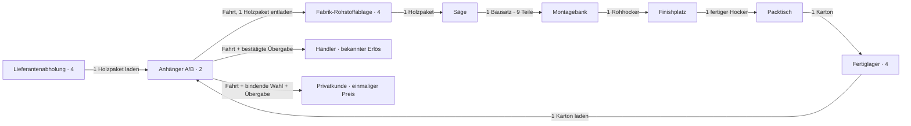

# Verladekette für Hocker01

Stand 12. November 2026. **P01-04**, Entwurf Version 1. Mengen und Plätze sind Prüfwerte. [Rezept und Stationen](PRODUCTION.md) bestimmen die Warenfolge, [Maßblatt](DIMENSIONS.md) die Hüllen und Ladehöhen. [STATE](../technical/STATE.md) und [ECONOMY](ECONOMY.md) bleiben für Bestand und Abrechnung verbindlich.

## Orte und Kapazitäten

| Getrennter Warenort | Prüfkapazität | Zulässige Ware |
| --- | --- | --- |
| Lieferantenabholung | 4 markierte Bereitstellplätze je Werkstatt | Je Platz 1 gekauftes Holzpaket |
| Anhänger A/B | 2 Universalplätze längs hintereinander | Je Platz 1 Holzpaket oder 1 geschlossener Hockerkarton; verschiedene Stufen dürfen getrennte Plätze belegen |
| Fabrik-Rohstoffablage | 4 markierte Plätze | Je Platz 1 Holzpaket |
| Vier Stationen | Je 1 Eingang, 1 Lauf und 1 Ausgang gemäß PRODUCTION | Nur die jeweils passende Stufe |
| Fertiglager | 4 markierte Plätze | Je Platz 1 geschlossener Hockerkarton |
| Händlerannahme | Eigener physischer Punkt; 1 aktive Übergabe je Werkstatt | 1 Karton je Verkaufs-ID |
| Privatannahme | Separater physischer Punkt; 1 aktive Übergabe je Werkstatt | 1 Karton je Verkaufs-ID |

Es gibt keine Stapel, Teilpakete oder zusammengelegten Chargen. Für Käuferannahmen wird vor der Aufnahme eine freie Annahme reserviert; sie sind kein zusätzliches spielereigenes Lager. Bausatz, Rohhocker und unverpackter fertiger Hocker bleiben innerhalb der Fabrik.

**Beschaffung braucht einen garantierten Entladeplatz:** Ein Kauf reserviert vor Geldabgang sowohl einen freien Lieferantenplatz als auch einen freien Fabrik-Rohstoffplatz für genau dieses Paket. Ohne einen der beiden Plätze wird weder Geld abgezogen noch neue Ware erzeugt. Der Fabrikplatz zählt gegen die Kapazität 4 und bleibt über Abholung und Fahrt für die bezahlte Charge reserviert. Beim Entladen wird genau diese Reservierung durch die Ware ersetzt. Andere Chargen dürfen den Platz nicht belegen; eine eigene Reservierung ist bei der eigenen Ablage zulässig. Diese Zusage darf während der offenen bezahlten Lieferung nicht einfach durch Timeout verfallen. So kann ein Anhänger voller Holz immer zu seinen freien Entladeplätzen zurückkehren, statt bei vollem Fertiglager die Verkaufsfahrt zu blockieren.

Auch der später vorgesehene zweckgebundene Materialvorschuss muss dieselbe Lieferanten- und Entladeplatzprüfung verwenden; er darf diese Kapazitätsregel nicht umgehen.

Jeder Übergabepfeil enthält Quelle → sichtbare Hand → Ziel; auf internen Wegen übernehmen später Personal oder Band denselben Weg über ihre sichtbaren Träger. Eine Fahrt verändert keinen Warenort innerhalb des Anhängers. Vor Abfahrt sind die Hände frei, Ware liegt in bestätigten Slots und ist sichtbar befestigt. Normale Außenwege benötigen die zusammenhängende Fahrt zwischen den jeweiligen Ladezonen.

## Erlaubte Übergaben

Jede Aufnahme und Ablage prüft serverseitig Berechtigung, Eigentümer, Chargen-ID, Stufe, vollständige Menge 1, erreichbaren Ort und freien oder für dieselbe Charge reservierten Zielplatz. Eine Aufnahme reserviert den Quellplatz als garantierten physischen Rückgabeplatz bis zur erfolgreichen Zielablage; Details stehen im [Stationsvertrag](PRODUCTION.md#rückgabeplatz-während-des-transports).

| Vorgang | Quelle → Hand → Ziel | Menge je Übergabe | Zusätzliche Vorbedingungen |
| --- | --- | --- | --- |
| Beschaffung laden | Lieferantenplatz → Anhänger A/B | 1 Holzpaket | Kauf bestätigt; Fahrzeug in Lieferanten-Ladezone; freier Slot |
| Rohstoff entladen | Anhänger A/B → zugeordneter Rohstoffplatz | 1 Holzpaket | Fahrt zur Fabrik erfolgt; Fahrzeug in Fabrik-Ladezone; genau der seit Kauf für diese Charge reservierte Rohstoffplatz |
| Säge versorgen | Rohstoffplatz → `Saege.Input` | 1 Holzpaket | Sägeeingang frei, Rezept passend |
| Montage versorgen | `Saege.Output` → `Montage.Input` | 1 vollständiger Bausatz | 9 eingebettete Teile, Zuschnitt abgeschlossen |
| Finish versorgen | `Montage.Output` → `Finish.Input` | 1 Rohhocker | Montage abgeschlossen |
| Verpackung versorgen | `Finish.Output` → `Packen.Input` | 1 fertiger Hocker | Finish abgeschlossen |
| Fertigware einlagern | `Packen.Output` → Fertiglagerplatz | 1 Karton mit 1 Hocker | Verpackung abgeschlossen; freier Lagerplatz |
| Verkaufsfahrt laden | Fertiglagerplatz → Anhänger A/B | 1 Karton | Fahrzeug in Fabrik-Ladezone; freier Slot |
| Händler beliefern | Anhänger A/B → Händlerannahme | 1 Karton je Verkaufs-ID | Plausible Fahrt; richtige Ladezone; freie reservierte Annahme; Menge und Erlös sichtbar; physische Übergabe bestätigt |
| Privatkunde beliefern | Anhänger A/B → Privatannahme | 1 Karton je Verkaufs-ID | Plausible Fahrt; richtige Ladezone; freie reservierte Annahme; Händlervergleich und Privatspanne sichtbar; bindende Wahl vor Preisenthüllung |
| Rückgabe | Hand → exakt der reservierte ursprüngliche Quellplatz | Dieselbe unveränderte Charge | Tatsächlich zurücktragen; keine Fremdware oder zusätzliche Charge; Rückgabe bleibt auch nach Rezeptwechsel möglich |

Es gibt höchstens zwei Warenposten im Anhänger. Eine behauptete Ankunft, eine Berührung oder ein Clientauftrag ersetzt weder die gefahrene Strecke noch die bestätigte Käuferübergabe. Ein Auftrag ist keine Produktionsvoraussetzung.

## Geld und Bestätigung

Der getrennte Wirtschaftstest verwendet Einkauf **60 je Holzpaket**, Händlerwert **100 je Karton** und Privatspanne **80 bis 120 je Karton**. Ein Kauf bucht Geld und Bereitstellung am Lieferanten gemeinsam. Kein Paket entsteht dadurch direkt im Fahrzeug oder Fabriklager.

Nur die bestätigte physische Käuferübergabe erlaubt Warenabgang und Gutschrift. Vor der bindenden Privatwahl sind Spanne und Händlervergleich sichtbar; der endgültige Betrag wird danach einmal für die Verkaufs-ID ermittelt. Warenabgang, Betrag und Abschluss werden gemeinsam gemäß STATE gespeichert, bevor das endgültige Ergebnis erscheint. Wiederholung und Wiederbeitritt verwenden denselben Betrag. Wird vor Bestätigung abgebrochen, bleibt die Ware auf der Hand oder wird zum reservierten Fahrzeugslot zurückgetragen; es wird kein Preis enthüllt.

## Fehlerfälle und Freiräumen

| Fall | Erhaltener Ort / nächster Schritt |
| --- | --- |
| Ziel voll, reserviert, unerreichbar oder falsche Zone | Keine Ablage; Ware bleibt am bestätigten Quellort oder auf dem Träger. Getragene Ware kann zum reservierten Ursprung zurückgebracht werden. |
| Falsche Stufe, Teilmenge oder fremde Ware | Keine Umbuchung; Quelle, Ziel und Geld bleiben unverändert. |
| Zwei Akteure für dieselbe Ware oder denselben Platz | Höchstens eine Reservierung gewinnt; andere Aktion wird verständlich abgewiesen. |
| Bestätigte Übergabe wird wiederholt | Vorhandenes Ergebnis, kein zweiter Warenabgang oder Erlös. Neue ID ohne Quellware wird abgewiesen. |
| Abbruch vor Aufnahme | Vorläufige Reservierung freigeben, Ware bleibt an der Quelle. |
| Abbruch nach Aufnahme | Quellplatz als Rückgabeplatz erhalten; physisch zurückbringen oder bestätigten Transport zum Ziel fortsetzen. Keine freie Timeout-Umbuchung. |
| Karton in Hand, Fertiglager und Anhänger voll | Karton physisch auf seinen reservierten Ursprung zurücklegen. Mit freien Händen Fahrzeugladung ausliefern; danach Lagerware verladen und den Rückstau von hinten lösen. |
| Anhänger vollständig mit Holz belegt, Fertiglager voll | Holz auf die seit Einkauf garantierten Rohstoffplätze entladen. Die Plätze können nicht zugleich von anderen Chargen belegt sein. Danach Kartons laden und ausliefern. Weitere Einkäufe ohne freien Rohstoffzielplatz sind gesperrt. |

Ein Rückgabeplatz ist eine Reservierung, kein zweiter Warenbestand. Bei Trägerverlust muss die bestätigte Wiederherstellung entweder den Träger wiederherstellen oder die Charge genau einmal dem reservierten Ursprung zuordnen. Die Darstellung und Freigabe erfolgen anhand desselben gespeicherten Zustands; Wiederbeitritt ist keine Lieferung zum Ziel. Die tatsächliche Speicher- und Abbruchfunktion wird in P04/P06 geprüft.

## Papierlauf mit zwei Chargen

Isolierter Test: 120 Spielgeld, leere Plätze, Chargen A/B. Dies legt kein Startgeld und keine kostenlose Erstladung fest.

1. Zwei Pakete für je 60 beim Lieferanten kaufen, einzeln in A/B laden. Ergebnis: Geld 0, Anhänger 2/2, Lieferantenplätze frei, Rohstoffablage 0 belegt + 2 reserviert von 4, Hände frei.
2. Zur Fabrik fahren, beide Pakete einzeln auf ihre garantierten Rohstoffplätze bringen. Ergebnis: Rohstoffe 2 belegt + 0 reserviert von 4, Anhänger 0/2, Hände frei.
3. Jede Charge durch alle vier Stationen tragen. Ergebnis: zwei Kartons im Fertiglager 2/4, Rohstoffe und Stationen leer. Kein Kundenauftrag.
4. Kartons einzeln in A/B laden, mit freien Händen zum Händler fahren, beide Übergaben separat bestätigen. Ergebnis: Bestand 0, zwei Verkaufs-IDs, Geld 200; Überschuss zum Testbudget 80.
5. Privatfälle separat ab Stand vor Käuferübergabe: je Karton gezielt 80 bzw. 120 festlegen. Zwei Kartons ergeben entsprechend 160 bzw. 240; Wiederholung ändert keinen Betrag. Eine zusätzliche Prüfung mit einem Holzpaket und einem Karton in getrennten Slots verwendet nur die jeweils passende Entladezone.

Papierergebnis: Jede Umbuchung hat Quelle, Ziel und Menge; maximal zwei Fahrzeugplätze und je vier Lager-/Lieferantenplätze reichen. Fahrten, Bedienung, sichtbare Last, Wiederherstellung und Abrechnung sind noch im Spiel zu prüfen. Nachweis: [P01-03 bis P01-06](../evidence/P01-03-06.md).
