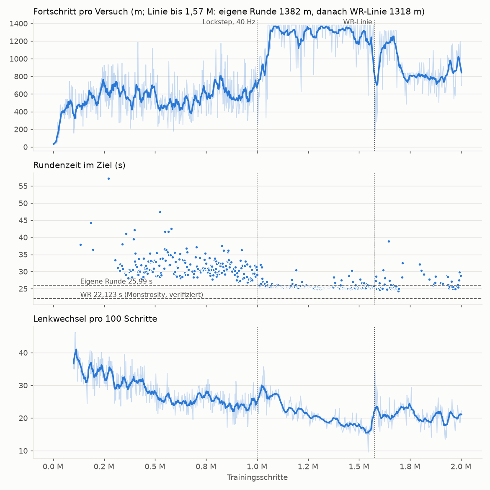

# PolyTrack RL – Bericht (Stand 2026-10-22)

Strecke **Summer 1** (offizielle Version 0.6.3, itch.io), PPO (stable-baselines3), 2 Mio. Trainingsschritte
in einem Lauf (`models/summer1_20261015_114307`). Keine Bot-Zeit wurde je hochgeladen: Jeder
`POST /v6/leaderboard` des Spiels wurde von der Sperre in `env/browser.py` abgefangen.

## Ergebnis

| | Zeit |
|---|---|
| Weltrekord (Monstrosity, verifiziert, 0.6.3) | **22,123 s** |
| Eigene Runde (Referenzlinie, manuell gefahren) | 25,991 s |
| **Agent – schnellste Trainingsrunde** | **24,286 s** (Schritt 1.689.987) |
| **Agent – beste reproduzierbare Fahrt** (Auswertung, Video) | **24,562 s** |

Der Agent fährt schneller als die menschliche Referenzrunde, ist aber noch ~2,2 s vom Weltrekord entfernt.

## Verlauf

| Schritte | Aufbau | Beobachtung |
|---|---|---|
| 0 – 1,0 M | Tastatur, 20 Hz, Echtzeit (später 2×), eigene Referenzlinie | lernt die Strecke; erste Zielankunft bei 132 k (37,9 s), Bestzeit 26,36 s bei 993 k. Auswertung ohne Zufall: nur 1 von 3 Fahrten im Ziel (26,769 s) – Tastatur-Timing schwankt 50–66 Frames/Schritt, Fahrten nicht reproduzierbar |
| 1,0 – 1,57 M | **Lockstep** (frame-genau, deterministisch), 40 Hz, Fortschritt bis zum nächsten Checkpoint gedeckelt, Abkürzungen erlaubt | großer Sprung: fast jede Fahrt kommt durch, Zeiten konstant ~25 s, Bestzeit 24,704 s; Lenkwechsel sinken auf ~16 pro 100 Schritte |
| 1,57 – 2,0 M | Referenzlinie = **WR-Linie** (Replay der Leaderboard-Aufnahme) | Leistung bricht ein (Ø ~800 m statt ~1300 m pro Versuch, seltener im Ziel); Bestzeit trotzdem 24,286 s. 425 k Schritte reichen nicht zum Umgewöhnen |

Belohnung (Endstand, `config.yaml`): Fortschritt entlang der Linie, Speed-Bonus in Fahrtrichtung,
Checkpoints, Zeitbonus im Ziel; Strafen für Zeit, Stillstand, Wandkontakt (Kollisionsstöße),
Lenkwechsel und Abflug.

## Auswertung

Modell `best_time.zip` (Schritt 1.689.987), Lockstep 40 Hz, WR-Linie. Dateien in
`models/summer1_20261015_114307/eval/`.

| Modus | Ergebnis |
|---|---|
| ohne Zufall (immer wahrscheinlichste Aktion), 2 Fahrten | beide **bitgenau identisch**, aber nicht im Ziel (bleibt nach 860 m hängen) → `best_time_det.*` |
| 30 Fahrten mit der normalen Aktionsverteilung (Seeds 0–29) | **13/30 im Ziel**, Zeiten 24,56–32,2 s, Median der Zielankünfte ~24,9 s → `best_time_search.json` |
| Bestfahrt (Seed 15) als Eingabefolge in Echtzeit nachgefahren | **24,562 s, exakt reproduziert**, 22,5 Lenkwechsel/100 Schritte → `best_time_best_run.webm`, `best_time_best_actions.json` |

Da die Simulation im Lockstep deterministisch ist, reproduziert eine gespeicherte Eingabefolge ihre Fahrt
auf die Millisekunde. Beim Zieleinlauf versuchte das Spiel jeweils, die Zeit hochzuladen
(`POST /v6/leaderboard`) – blockiert.

Frühere Auswertung (Schritt ~993 k, Tastatur, 20 Hz, eigene Linie): 1 von 3 Fahrten im Ziel, 26,769 s.

## Was als Nächstes zu verbessern wäre

1. **Vom Weltrekord lernen (Behavior Cloning).** Die WR-Aufnahme liefert die exakte Eingabe für jeden
   Frame, und sie lässt sich frame-genau nachfahren (Replay = 22,123 s exakt). Damit kann man die Policy
   vor dem RL-Training auf die WR-Fahrt vortrainieren, statt dass sie die Linie selbst finden muss.
2. **Linienwechsel nicht mitten im Training.** Ein frischer Lauf auf der WR-Linie (oder Behavior Cloning
   wie oben) statt eines Wechsels nach 1,57 M Schritten.
3. **Feinere Steuerung:** analoge Lenkung gibt es im Spiel nicht, aber 50–100 Hz Entscheidungen und das
   Gas loslassen zum Einlenken (wie Top-Fahrer) brauchen mehr Training.
4. **Mehr Rechenzeit:** Lockstep läuft mit ~165 Schritten/s (3 Instanzen). Limit ist der Laptop
   (CPU/RAM) und das Schulnetz (DNS-Aussetzer beim Laden).
